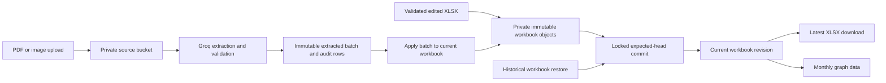

# JagBooks

FastAPI backend using Supabase Auth, Postgres, private source-document Storage, and rolling XLSX workbooks. The Next.js frontend provides Home, Analysis, and a source review flow inside Analysis. The backend includes its own extraction code and workbook template.

## Feature and implementation map

This is the implementation inventory. “Implemented” means backend code exists and is covered by local tests; it does not imply a completed frontend or a successful live provider login/upload.

| Feature | Current behavior / boundary | Implementation |
| --- | --- | --- |
| Supabase OAuth session authentication | Verifies Supabase-issued access JWT against Auth on every protected request; works independently of whether Google or another provider created the session | [`app/auth.py`](backend/app/auth.py): `get_db`; [`app/database.py`](backend/app/database.py): `Supabase.request` |
| Google provider diagnostics | Reads live `/auth/v1/settings`, reports whether Google is enabled and derives the correct project callback; never claims full browser-login verification | [`app/auth.py`](backend/app/auth.py): `provider_status`; `GET /auth/providers` |
| Current user and finance access diagnostics | Returns verified account identity and separately checks RLS-visible group membership; sign-in alone grants no finance access | [`app/main.py`](backend/app/main.py): `/auth/me`, `/auth/access` |
| Callback configuration guard | Optional configured callback must belong to the same project and use `/auth/v1/callback`; rejects the wrong project and `/auth/v1/oauth/callback` | [`app/database.py`](backend/app/database.py): `settings`, `oauth_callback_url` |
| Read-only auth readiness command | Checks live Google enablement; optionally verifies a real access token and membership without printing secrets/profile data | [`scripts/check_auth.py`](backend/scripts/check_auth.py) |
| Group isolation | Operator-controlled group members; RLS on finance tables and private bucket objects; ownership derived from Auth user | [`0001_finance.sql`](backend/migrations/0001_finance.sql) through [`0004_rolling_workbooks.sql`](backend/migrations/0004_rolling_workbooks.sql) |
| Logical sheet creation/listing | Creates a named logical sheet and initializes its current XLSX; lists accessible sheets | [`app/main.py`](backend/app/main.py): `create_sheet`, `sheets`; [`app/rolling.py`](backend/app/rolling.py): `initialize` |
| Workbook template | Bundled template with opening balances, tables, styles, formulas, and fiscal-month columns | [`app/assets/finance-template.xlsx`](backend/app/assets/finance-template.xlsx); [`app/workbooks.py`](backend/app/workbooks.py) |
| PDF/image upload | Streams up to 10 MiB; checks MIME/signature; stores original before attempting extraction and workbook update | [`app/main.py`](backend/app/main.py): `upload`, `valid_signature`, `store_upload` |
| Source deduplication/recovery | SHA-256 uniqueness per sheet; interrupted upload can recover stored bytes/metadata without overwriting original | [`app/main.py`](backend/app/main.py): `store_upload`; `finance_files` constraints |
| Source browsing/private download | Paginated source list includes whether source belongs to active workbook lineage; five-minute signed download links | [`app/main.py`](backend/app/main.py): `files`, `download`; [`app/database.py`](backend/app/database.py): `signed_url` |
| Text PDF extraction | PyMuPDF, unlocked PDFs, at most 50 pages and 120,000 text characters; scanned PDFs require page images | [`app/extraction.py`](backend/app/extraction.py): `extract` |
| Handwriting/image labeling | Sends image bytes to configurable Groq vision model | [`app/extraction.py`](backend/app/extraction.py): image branch |
| Financial classification | Root inference rules adapted into backend; integer cents, bounded fields, known category/class mapping, no invented missing values | [`app/classification_prompt.py`](backend/app/classification_prompt.py); [`app/models.py`](backend/app/models.py); [`app/schemas.py`](backend/app/schemas.py) |
| Atomic extraction persistence | Saves draft audit rows, immutable extracted batch, and processed status together; repeated completion does not duplicate rows | `finance_finish_extraction` in [`0004_rolling_workbooks.sql`](backend/migrations/0004_rolling_workbooks.sql) |
| Automatic rolling updates | Complete valid batch adds category/month totals onto actual current XLSX, preserving manual corrections; invalid/incomplete batch does not partially publish | [`app/workbooks.py`](backend/app/workbooks.py): `apply_batch`; [`app/rolling.py`](backend/app/rolling.py): `source_update` |
| Latest workbook download/metadata | Downloads exact current bytes; includes version UUID in ETag/X-Workbook-Version; metadata endpoint identifies head | [`app/main.py`](backend/app/main.py): `latest_workbook`, `workbook_head`; [`app/rolling.py`](backend/app/rolling.py): `bytes_for` |
| Manual edited-workbook replacement | Uploaded XLSX becomes exact new current object; keeps layout/formula locations and source tracking; requires downloaded version UUID | [`app/main.py`](backend/app/main.py): `replace_workbook`; [`app/rolling.py`](backend/app/rolling.py): `manual_replace`; [`app/workbooks.py`](backend/app/workbooks.py): `validate` |
| Full workbook history/checkpoints | Append-only numbered revisions with parent, operation, actor, object/checksum, source tracking, and summary; checkpoint can reuse immutable bytes | `finance_workbook_objects`, `finance_workbook_revisions`; [`app/main.py`](backend/app/main.py): `snapshot`, `versions`, `export` |
| Restore | Creates new current revision using historical target bytes/summary/source lineage; later history is retained | [`app/rolling.py`](backend/app/rolling.py): `restore`; `finance_commit_workbook` |
| Concurrent-edit protection | Sheet lock and expected-head comparison prevent lost updates; stale manual replacement/restore gets 409; missing replacement precondition gets 428 | [`0004_rolling_workbooks.sql`](backend/migrations/0004_rolling_workbooks.sql): `finance_commit_workbook`; [`app/rolling.py`](backend/app/rolling.py): `commit` |
| Source retries/rebase | Reuses cached extraction and rebases up to three times after concurrent change; applies source once per active lineage | [`app/rolling.py`](backend/app/rolling.py): `source_update` |
| Graph-ready financial totals | Monthly revenue/expense/net derived from current workbook numeric inputs; reflects manual edits/restores and powers analysis charts | [`app/workbooks.py`](backend/app/workbooks.py): `summary`; [`app/main.py`](backend/app/main.py): `summary` |
| Audit transaction list/add/review | Separate draft/approved/rejected ledger with integer cents and bounded schema; editing audit rows does not rewrite authoritative workbook | [`app/main.py`](backend/app/main.py): `transactions`, `add_transaction`, `review`; [`app/schemas.py`](backend/app/schemas.py) |
| Legacy snapshot compatibility | Old transaction-only JSON snapshots remain listable/downloadable as ledger XLSX; cannot restore them as full-template workbooks | [`app/spreadsheet.py`](backend/app/spreadsheet.py); [`app/main.py`](backend/app/main.py): `transaction_snapshots`, `export` fallback |
| Safe request logging | Correlation IDs, approved route templates, status/duration, safe errors; excludes financial bodies, tokens and raw provider messages | [`app/observability.py`](backend/app/observability.py) |
| Health/API schemas | Configuration-only health endpoint; FastAPI `/docs`, `/redoc`, `/openapi.json` | [`app/main.py`](backend/app/main.py) |
| Deployment preparation | Validates environment only; does not mutate live schema or seed demo data | [`scripts/deploy_setup.py`](backend/scripts/deploy_setup.py); [`pyproject.toml`](backend/pyproject.toml) |
| Automated coverage | API/transport/auth tests, real XLSX math/preservation, replacement/restore/race tests, logging isolation; SQL verification rolls back fixtures | [`backend/tests/`](backend/tests/) |

### Code ownership

```text
bvw-debate/
├── README.md                  Feature map, setup, OAuth, routes, operational limits
├── ARCHITECTURE.md            Data flow, authority, consistency and storage guarantees
├── AGENTS.md                  Repository/change boundaries
├── frontend/                  Next.js finance workspace and Google sign-in
├── vercel.json                Existing Services topology; frontend is public entry
└── backend/
    ├── app/main.py            HTTP endpoints and upload orchestration
    ├── app/auth.py            Verified bearer auth and provider diagnostics
    ├── app/database.py        Supabase REST/Storage transport and env validation
    ├── app/extraction.py      PDF/image input → Groq → validated draft batch
    ├── app/classification_prompt.py  Adapted original accounting rules
    ├── app/models.py          Financial class/category dictionary
    ├── app/schemas.py         Bounded request/extraction models
    ├── app/workbooks.py       Template mapping, validation, additive changes, summaries
    ├── app/rolling.py         Storage objects, latest pointer, retries, replacement/restore
    ├── app/spreadsheet.py     Legacy transaction-only XLSX export
    ├── app/observability.py   Safe request logging and errors
    ├── app/assets/            Packaged workbook template
    ├── migrations/            Versioned Postgres/RLS/bucket/function changes
    ├── scripts/               Config validation and read-only auth probe
    └── tests/                 Local tests and rollback-only SQL verification
```

### Data and storage map

| Supabase object | Responsibility |
| --- | --- |
| `auth.users`, `auth.identities` | Supabase-managed account identity and Google/provider links |
| `finance_groups` | Finance organization/workspace |
| `finance_members` | Operator-granted user access to group |
| `finance_sheets` | Logical named workbook and `current_workbook_id` |
| `finance_files` | Immutable original-document metadata and upload/extraction status |
| `finance_transactions` | Editable extraction/audit ledger; not authoritative workbook cells |
| `finance_extractions` | Immutable original extracted batches reused on retry/reapply |
| `finance_workbook_objects` | Immutable XLSX object path, size, checksum and creator |
| `finance_workbook_revisions` | Full workbook version lineage, operation and derived summary |
| `finance_sheet_versions` | Legacy transaction-only snapshots |
| Bucket `bvw-finance-files` | Private original PDFs/images |
| Bucket `bvw-finance-workbooks` | Separate private immutable XLSX versions |
| `finance_is_member` | RLS membership predicate |
| `finance_finish_extraction` | Atomic extraction/audit persistence |
| `finance_commit_workbook` | Locked expected-head publication, restore/checkpoint semantics |
| `finance_snapshot`, `finance_summary` | Legacy audit-ledger snapshot/aggregation compatibility |



### Not yet implemented or not verified live

- Full revision history and restore UI. The existing backend endpoints remain available.
- Full Google OAuth login verification. Provider enablement can be checked with configured project key; successful browser consent/callback/token exchange still needs a live sign-in using a configured Google account.
- Live Storage byte-transfer and live Groq verification. SQL rollback tests cover database behavior and synthetic Storage metadata, not actual file bytes.
- Background worker/job queue, per-job progress, cancellation, durable automatic retries, automatic abandoned-object cleanup, source/history deletion, and notifications.
- OCR of scanned PDFs, password-protected PDF support, fiscal-period restructuring, workbook formula evaluation on server, and a full double-entry accounting/reconciliation engine.
- Automatic reconciliation of overlapping but byte-different documents, or reverse-sync of edited workbook cells into individual audit transactions.
- Google Sheets synchronization, frontend administration for group membership, and production deployment verification.

### Migration and test map

| File | Scope |
| --- | --- |
| `0001_finance.sql` | Base groups/members/sheets/files/audit/snapshots, source bucket/RLS, initial extraction/snapshot functions |
| `0002_finance_constraints.sql` | Category/class and source-path checks; least-privilege grants |
| `0003_finance_integrity.sql` | Immutable source metadata/state transitions, actor policies, legacy summary function |
| `0004_rolling_workbooks.sql` | Immutable extraction batches, workbook bucket/objects/revisions, current pointer and CAS commit function |
| `tests/test_api.py` | API behavior, upload retry/dedup, validation, safe provider transport, legacy export |
| `tests/test_rolling.py` | Actual XLSX accumulation/preservation, manual replacement, restore/reapply, race rebasing, version endpoints |
| `tests/test_auth.py` | OAuth-issued user verification, bearer isolation, Google diagnostics, callback mismatch detection, uninvited/anonymous denial |
| `tests/test_deploy_setup.py` | Configuration validation without database mutation |
| `tests/test_observability.py` | Concurrent request correlation and secret-safe errors |
| `tests/verify_supabase.sql` | Rollback-only real Postgres RLS, atomic extraction and ledger constraints |
| `tests/verify_rolling.sql` | Rollback-only real Postgres head/version/restore/CAS/RLS checks with synthetic Storage metadata |

## Google OAuth configuration and verification

Google sign-in uses **Supabase social sign-in**, not the separate Supabase OAuth 2.1 server feature. The finance project is `wskxghlkmkopatlxylxj`.

Two different callback URLs have different owners:

1. **Google → Supabase:** Google Cloud OAuth client's Authorized redirect URI must be `https://wskxghlkmkopatlxylxj.supabase.co/auth/v1/callback`. There is no `/oauth` segment. Register the Google client ID/secret in this same Supabase project's Google provider settings. These Google secrets do not belong in Python or browser code.
2. **Supabase → app:** The app redirects to `/analysis`, where Supabase JS exchanges the callback code. Add the full analysis URL to the Supabase Auth redirect allowlist.

The browser's Supabase client should use PKCE, preserve its verifier across redirects, exchange the returned authorization code with Supabase, and send the resulting **Supabase access token** to FastAPI. A Google access token, Google ID token, or OAuth authorization code is not a substitute for that bearer token. Backend verifies the Supabase user with `/auth/v1/user` and forwards the same token to Data API/Storage so RLS still applies. User-editable profile metadata never grants finance membership. Anonymous accounts are rejected.

Optional `SUPABASE_OAUTH_CALLBACK_URL` validates the configured Google→Supabase callback against `SUPABASE_URL`. The backend rejects a different project's callback or `/auth/v1/oauth/callback`; this local guard does not edit Google/Supabase dashboard settings.

New diagnostic endpoints:

| Endpoint | Meaning |
| --- | --- |
| `GET /auth/providers` | Reads live Auth settings with publishable key; reports Google enablement, expected provider callback, and explicitly marks full login verification false |
| `GET /auth/me` | Verifies an actual access token and returns only account ID/email |
| `GET /auth/access` | Verifies token and reports RLS-visible groups and `can_access_finances`; does not grant membership |

Read-only readiness probe:

```sh
cd backend
uv run python -m scripts.check_auth
```

With `SUPABASE_TEST_ACCESS_TOKEN` set locally to a real current OAuth-issued Supabase access token, the same command also checks account verification and finance-group visibility. Never paste the token into chat or commit it. Without a token it reports `user_session_test: "not_run"`. Provider enabled, valid user session, and group access are three separate checks; none alone proves a completed browser OAuth flow.

Local UI and backend tests do not establish successful Google consent or provider connectivity. Use a configured project and an authorized account to verify the live sign-in and finance access.

Official references: [Google social sign-in](https://supabase.com/docs/guides/auth/social-sign-in/auth-google), [redirect URL configuration](https://supabase.com/docs/guides/auth/redirect-urls), [PKCE flow](https://supabase.com/docs/guides/auth/sessions/pkce-flow).


## Setup

From the repository root, run `cp .env.example .env.local` for a fresh setup and fill in the keys. FastAPI loads this single local file from any working directory. Environment variables already set in the process take precedence. The Next.js app can fetch the public Supabase configuration from FastAPI, so local development only requires the root file.

```sh
cd backend
uv sync --extra dev --locked
uv run uvicorn app.main:app --reload --no-access-log
```

Set these variables in the root `.env.local` for local use and in Vercel's environment settings for deployment:

```dotenv
SUPABASE_URL=https://wskxghlkmkopatlxylxj.supabase.co
SUPABASE_PUBLISHABLE_KEY=<project publishable key>
SUPABASE_OAUTH_CALLBACK_URL=https://wskxghlkmkopatlxylxj.supabase.co/auth/v1/callback
GROQ_API_KEY=<Groq key>
GROQ_TEXT_MODEL=openai/gpt-oss-120b
GROQ_VISION_MODEL=qwen/qwen3.8-27b
```

No runtime service-role key, SQLite file, Neon configuration, or shared local output workbook is used. Build setup validates environment configuration; it never migrates/seeds the live database.

Migrations `backend/migrations/0001_finance.sql` through `0004_rolling_workbooks.sql` were applied through Supabase MCP to the confirmed BVW project. Apply them once in numeric order for a fresh separate project. Existing unrelated `public.users`, `uploads`, and `statements` are preserved.

Create the coach in Supabase Auth, then grant membership as an operator through the SQL editor. Replace the placeholder with the existing Auth user's UUID:

```sql
insert into public.finance_members(group_id, user_id)
select id, '<coach-auth-user-uuid>'::uuid
from public.finance_groups
where name = 'BVW Debate Financial Consolidation'
on conflict do nothing;
```

All financial requests need `Authorization: Bearer <current Supabase access JWT>`. Backend validates the token through Supabase Auth and forwards it to Data API/Storage. RLS restricts rows and files to group members. Sign-in, token refresh, and sign-out belong to Supabase Auth; public registration never grants finance membership.

## Frontend setup

Deploy the repository root as one Vercel Services project. The root `vercel.json` builds Next.js and FastAPI together. Vercel automatically injects the private `JAGBOOKS_FASTAPI_BINDING` into Next.js. Set the Supabase and Groq variables from Setup on the deployment. The browser calls same-origin Next.js routes, and Next.js reads the browser-safe Supabase config through the binding. No backend URL needs to be entered in project settings.

For local development, use `npm run dev:services` from the repository root to run both services with the same binding. You can also run Uvicorn at `127.0.0.1:8000` and `npm run dev` in `frontend/`. The standalone Next.js development server defaults to that loopback address.

Add `http://localhost:3000/analysis` and the deployed app's exact `/analysis` URL to the Supabase Auth redirect allowlist. On return, the app exchanges the code once with its saved PKCE verifier and removes callback parameters from the URL. Supabase JS refreshes the browser session. Workspace access requires a verified OAuth session on a Google-linked account and operator-granted group membership.

Home shows a blank statement layout before sign-in and the current private statement after access is verified. Analysis provides three workbook tabs, row filtering, formula inspection, monthly operating and cash flow charts, and XLSX download/replacement. Charts calculate operating totals from input rows. Net cash flow follows the template's monthly cash flow expression and bank deposit link. Months with changed, unsupported cash flow formulas are displayed as unavailable. Open Excel for full formula recalculation.

Vercel Functions limit request and response bodies to 4.5 MB. The deployed browser upload flow caps files at 4 MiB to stay within that limit. Standalone local development supports the backend's 10 MiB upload limit. See [Vercel Functions limits](https://vercel.com/docs/functions/limitations).

### Reviewed source uploads

Analysis uploads PDF, PNG, JPEG or WebP to `POST /sheets/{id}/files?review=true&filename=...`. FastAPI stores the original privately and returns its source ID. The review page calls `POST /files/{id}/review` to extract the draft and calculate the before/after changes against the current workbook. `PUT /files/{id}/review` with `expected_version_id` applies the reviewed batch. A competing change returns 409 and requires refreshing the review. Stored sources can be reopened from Analysis. The upload endpoint's default automatic behavior remains available to existing API callers.

## Rolling workbook workflow

1. `POST /sheets` with `group_id` and `name` creates a logical workbook and version 1 from the packaged template. Opening balances are preserved, as requested. Existing sheets with no workbook can use `POST /sheets/{id}/workbook/initialize`.
2. Upload raw PDF/image bytes to `POST /sheets/{id}/files?filename=report.pdf`, with matching `Content-Type`. Source is stored first; Groq extracts/classifies it; a complete valid batch is added onto the latest workbook's category/month cells. Response includes `file` and `workbook_version`.
3. Each change creates an immutable workbook revision and advances the same sheet's current pointer. Previous versions remain downloadable. New documents add to current amounts; they do not replace previous batches or rebuild from a blank template.
4. `GET /sheets/{id}/workbook` downloads the current XLSX. Its `X-Workbook-Version` header and `ETag` identify the downloaded version. `GET /sheets/{id}/workbook/head` returns current version metadata.
5. Edit numeric inputs offline. Upload the modified XLSX with `PUT /sheets/{id}/workbook?expected_version_id=<downloaded-version-uuid>`, raw file body and XLSX Content-Type. This replaces current workbook contents, records a new revision, and preserves source-application tracking. Future document additions start from these edited values.
6. `POST /versions/{id}/restore` with `{"expected_version_id":"<current-version-uuid>"}` makes that historical workbook current through a new revision. Later history is retained. Future document additions start from restored contents.

Stale replacements/restores return **409** rather than discard intervening edits. Replacing an existing workbook without an expected version returns **428**. Download the latest file and merge offline changes before retrying. Source additions automatically rebase after a concurrent change, up to three attempts; cached extraction is reused.

### Storage layout

- Originals: private bucket `bvw-finance-files`, path `<group>/<file>/source`.
- Workbooks: separate private bucket `bvw-finance-workbooks`, path `<group>/<sheet>/versions/<object>.xlsx`.
- Postgres stores immutable object checksums, revision history, and each logical sheet's current version pointer. Latest is a pointer to immutable bytes; physical files are never overwritten.

Uploading bytes completes before a version can become current. Postgres checks Storage object presence and atomically publishes the revision/current pointer under a sheet lock. Failed uploads or conflicting writers cannot replace current. Uncommitted staging objects may remain private for operator cleanup; no automatic deletion runs on financial history.

### Template and accounting behavior

The packaged template retains the three source tabs, month columns (Aug 2026–May 2027), tables, styles, formulas, and opening balances. Only targeted numeric input cells change during document updates. Bank deposits update the Balance Sheet's numeric Bank Deposits row, preserving Cash Flow's linked Cash Deposits formulas. Unlike the prototype's batch-replacement behavior, updates accumulate on existing values, including manual corrections. No secondary accounting entries are invented.

Manual XLSX uploads must keep the current workbook's tabs/order, table layout, row labels, month columns, dimensions, and formula-cell locations. Numeric values may change; formula expressions may change in existing formula cells. Mapped input cells must remain numeric/blank, within limits and with at most two decimals. Workbooks with macros/external workbook links are rejected. Excel/LibreOffice recalculates formulas when an automatically updated file opens; Python preserves formulas and does not act as a spreadsheet calculation engine. Existing template formulas are preserved, not independently audited as a complete accounting model.

Automatic workbook posting is enabled as requested. Extracted audit transactions retain `draft` review status: automatic labels are not human verification. A complete batch needs valid dates, descriptions, integer cents, and matching financial classes/categories. Missing values or dates outside template columns stop the workbook update; no partial batch is posted. Source and immutable extraction remain stored for inspection/retry/manual correction. A file's `processed` status means extraction finished; `applied_to_current_workbook` in file listings indicates whether it is included in the current workbook lineage.

Byte-identical uploads deduplicate per sheet and apply once in the current lineage. Manual workbook replacement retains applied source IDs, so a retry cannot undo intentional offline corrections by adding old documents again. Restore inherits the target version's applied source IDs; explicitly re-uploading/reprocessing a source excluded by that restore can add it again, using its cached extraction. Overlapping but byte-different reports still require human reconciliation.

`GET /sheets/{id}/summary` returns monthly revenue, expense, and net totals from the current workbook's numeric inputs. Thus manual replacements/restores affect graphs immediately. Transfers, assets, liabilities, and purchase orders do not enter operating totals. Transaction CRUD/review endpoints edit the separate extraction/audit ledger; they do not rewrite the authoritative rolling workbook. Use a workbook replacement for financial corrections. Old transaction-only snapshots remain downloadable but cannot be restored as full workbooks.

## Endpoint reference

| Action | Endpoint |
| --- | --- |
| OAuth provider diagnostics / access | `GET /auth/providers`, `GET /auth/access` |
| Current user / groups | `GET /auth/me`, `GET /groups` |
| List / create logical sheets | `GET /sheets`, `POST /sheets` |
| Upload and process document/image | `POST /sheets/{id}/files?filename=...` |
| List stored sources | `GET /sheets/{id}/files?offset=0` |
| Source signed download | `GET /files/{id}/download` (five minutes) |
| Retry extraction/workbook application | `POST /files/{id}/process` |
| Current workbook download / metadata | `GET /sheets/{id}/workbook`, `GET /sheets/{id}/workbook/head` |
| Manual workbook replacement | `PUT /sheets/{id}/workbook?expected_version_id=...` |
| Initialize a legacy sheet | `POST /sheets/{id}/workbook/initialize` |
| List versions / create checkpoint | `GET /sheets/{id}/versions?offset=0`, `POST /sheets/{id}/versions` |
| Historical workbook download | `GET /versions/{id}/download` |
| Restore workbook | `POST /versions/{id}/restore` |
| Graph data from current workbook | `GET /sheets/{id}/summary` |
| List / add audit transactions | `GET/POST /sheets/{id}/transactions` |
| Review audit transaction | `PUT /transactions/{id}` |
| List legacy transaction-only snapshots | `GET /sheets/{id}/transaction-snapshots` |

FastAPI `/docs` provides JSON schemas. Source uploads accept PDF, PNG, JPEG, or WebP up to 10 MiB; manual XLSX files have the same size limit. Use raw bytes, not multipart/JSON:

```sh
curl -X POST "http://127.0.0.1:8000/sheets/$SHEET_ID/files?filename=report.pdf" \
  -H "Authorization: Bearer $ACCESS_TOKEN" \
  -H 'Content-Type: application/pdf' --data-binary @report.pdf

curl "http://127.0.0.1:8000/sheets/$SHEET_ID/workbook" \
  -H "Authorization: Bearer $ACCESS_TOKEN" -D workbook-headers.txt -o latest.xlsx

curl -X PUT "http://127.0.0.1:8000/sheets/$SHEET_ID/workbook?expected_version_id=$VERSION_ID" \
  -H "Authorization: Bearer $ACCESS_TOKEN" \
  -H 'Content-Type: application/vnd.openxmlformats-officedocument.spreadsheetml.sheet' \
  --data-binary @edited.xlsx
```

PDF extraction supports unlocked text-based reports up to 50 pages/120,000 characters. Scanned PDFs need page images instead. Processing is synchronous; hosting request limits must cover a 90-second Groq call plus Storage/DB work. No durable background worker is implemented. Failed processing retains the source and includes its `file_id` in the error for retry.

## Verification

```sh
cd backend
uv run --extra dev --locked pytest -q
uv lock --check
```

`tests/verify_supabase.sql` checks membership, category constraints, atomic extraction, and legacy snapshots against Postgres. `tests/verify_rolling.sql` checks current-pointer publication, missing-upload guards, idempotency, stale-write conflicts, replacement/restore lineage, and immutable history/RLS. Both roll back all fixtures. The latter uses synthetic Storage metadata inside the transaction; it does not verify actual Storage bytes.

Local tests exercise real XLSX changes, formula/style/balance preservation, two-document accumulation, manual replacement followed by another upload, restore followed by new/reapplied documents, retries and race rebasing. Provider transport is simulated. Live Storage transfers and real Groq extraction still need configured API credentials. `/health` checks configuration, not provider connectivity.
